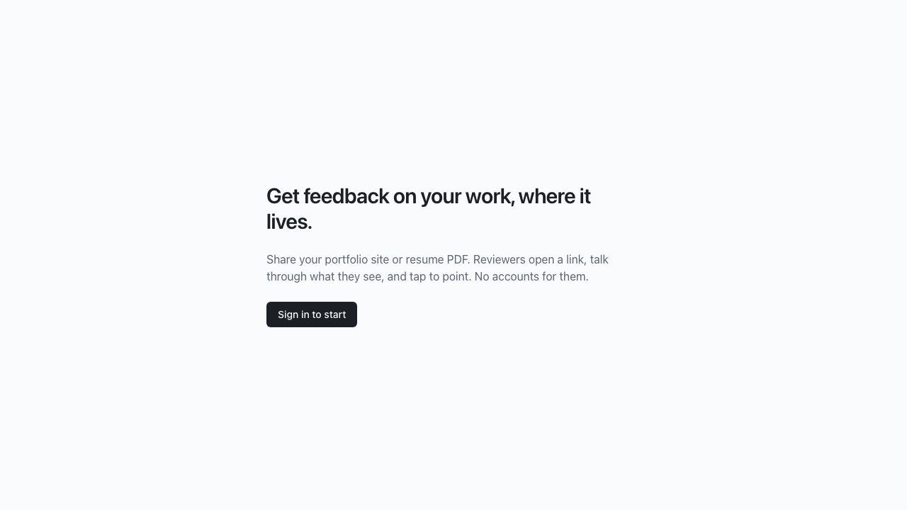

# M0: scaffold, local toolchain, schema + RLS, merge gate

## What / why
- pnpm monorepo: `apps/web` (Next 16 App Router, Tailwind 4), `apps/proxy` (Worker stub), `packages/shared` (zod anchors/timeline/postMessage protocol, D30 interfaces, D22 limits), `packages/anchoring`, `packages/overlay`.
- `supabase/migrations/20261103000001_init.sql`: SPEC §2 tables, enums, RLS (owners only see their own data; comments are visible to the owner only after submit (D20); owners can update only `addressed_at`/`anchor`/`anchor_source`, never reviewer text), Postgres token-bucket `take_token()` for rate limits, private storage buckets.
- Magic-link email template points straight at the app (`/auth/confirm`) so it works through phone tunnels (D31).
- D30 registry `apps/web/lib/server/adapters`: mock Transcriber/AnchorResolver/ScreenshotService/Mailer; local Mailer (Mailpit HTTP API) and local ProxyHost. `MOCK_AI=1` forces mock AI.
- Scripts: `pnpm setup` (idempotent), `dev`, `dev:stop`, `dev:phone` (cloudflared quick tunnels + QR), `verify` (gitleaks → prettier → typecheck → lint → unit → RLS DB tests → build → e2e chromium + webkit-iphone), `merge-task`.
- E2E runs against the production build on port 3100, so it never collides with `pnpm dev`.

## Acceptance covered
- ✅ `pnpm verify` green on the empty-app smoke test (chromium + webkit-iphone).
- ✅ `pnpm setup` re-run performs no actions.

## Screenshots

## Dependencies (runtime)
- `next`, `react`, `react-dom`: app framework (D16).
- `@supabase/supabase-js`, `@supabase/ssr`: Supabase DB/Auth/Storage client and cookie sessions (D16).
- `zod`: validation at every boundary (CLAUDE.md conventions).
- `@radix-ui/react-dialog`: accessible dialogs/sheets (UI convention).
- `server-only`: build-time guard so server modules can't be imported by client components.
- Versions are pinned to releases at least one day old; pnpm's release-age supply-chain policy is left on with no exclusions.

## Manual checks
None for M0.

## Known limitations
- Local Transcriber/AnchorResolver/ScreenshotService adapters throw "not built yet" until M1/M3; the proxy is a stub until M1.
- `pnpm dev:phone` tunnel flow is untested end-to-end until there's a UI worth opening (M2).
