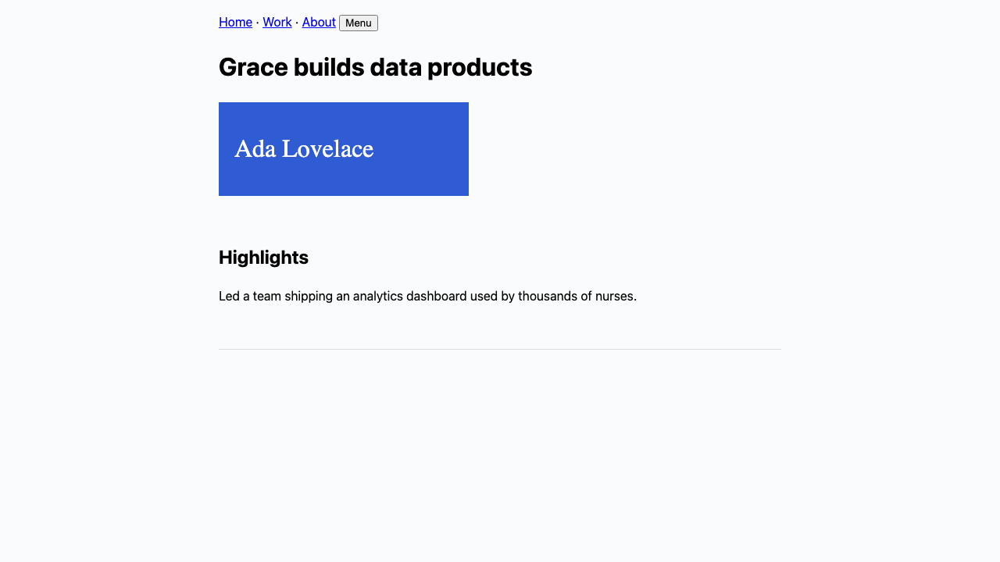
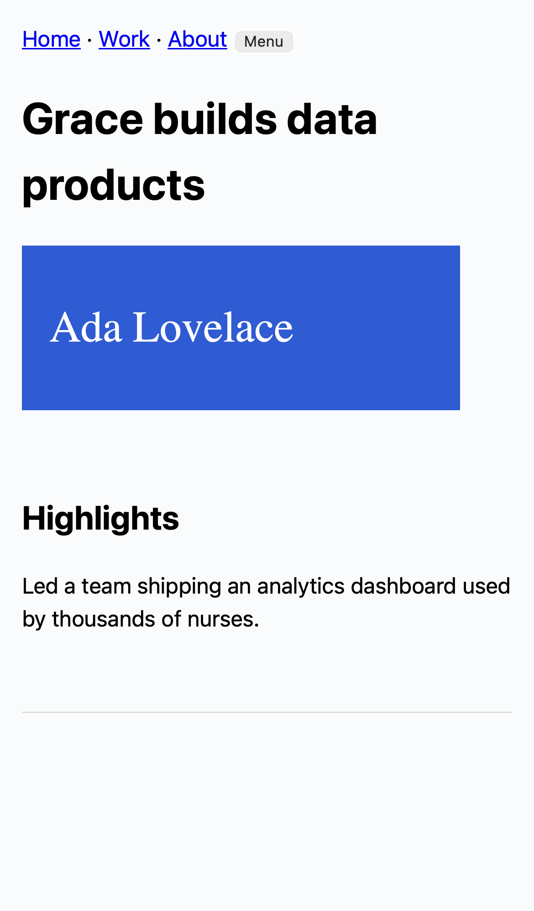

# M1: document proxy, overlay, anchoring, fixture e2e

## What / why
- **Worker (`apps/proxy`)**: `__enter` cookie flow (single host, path-preserving, SPEC §6). HMAC proxy tokens (`packages/shared/src/proxy-token.ts`, WebCrypto, shared by app and Worker; payload `{rid, etld1, origin, exp}`). SSRF guard on every upstream request: https only, DoH resolution, rejects any private/reserved v4/v6 address. GET/HEAD only. No cookies or auth forwarded upstream. Strips `Set-Cookie`, CSP, XFO, HSTS, COOP/COEP. Adds `noindex`, `no-store`, `no-referrer`, and `frame-ancestors` from `ALLOWED_APP_ORIGINS`. HTMLRewriter injects `<base>` + config + overlay first in `<head>`, removes meta CSP/manifest/existing `<base>`, rewrites same-host links to the proxy, same-eTLD+1 hosts via `/__host`, others to `_blank` + marked external. Upstream redirects are translated (same site stays in proxy; other sites → friendly page). 5 MB HTML cap, 10 s timeout, rate limits (600 req/10 min per token, 120 doc loads/10 min per IP). `/__health` reports status, XFO/CSP presence, platform fingerprint.
- **URL safety** (`packages/shared/src/url-safety.ts`): one validator for app and Worker. Decimal/octal/hex/short IPv4 forms, IPv4-mapped IPv6, ULA/link-local/NAT64/6to4, `.local`/`.internal`, credentials, ports, and names resolving to private IPs. `ALLOW_FIXTURE_HOSTS` is honored only when `ENVIRONMENT=test`.
- **Overlay (`packages/overlay`, 39 KB)**: answers a shell `ping` with `overlay:ready` (fixes a load-before-hydration race found by parallel e2e); patches `pushState/replaceState` (relative URLs would otherwise resolve against `<base>` and throw cross-origin SecurityError), reports `overlay:ready`/`nav`, blocks service worker registration and form submit. Record mode suppresses site clicks (capture-phase) while still allowing scroll, emits taps with full anchors and 1 s timeline snapshots of ≤40 visible candidates. Pick mode for typed comments. Shows/locates anchors with a numbered, non-color-only marker in a shadow root. Only accepts zod-validated messages from `APP_ORIGIN`.
- **Anchoring (`packages/anchoring`)**: builds DOM anchors (TextQuote with prefix/suffix, element descriptor, cssPath, nthPath, rectDoc, point) and re-anchors in SPEC §4.3 order: textQuote (exact → fuzzy, context-disambiguated) → cssPath/nthPath with descriptor check → rect at the same viewport width → `none` (caller shows screenshot).
- Shared schemas moved to `zod/mini` so the overlay bundle dropped from 459 KB to 39 KB. Still zod at every boundary.
- Test harness `/dev/harness` (404 unless `ENABLE_TEST_HARNESS=1` **and** a localhost `APP_ORIGIN`; unit-tested) lets e2e and `pnpm gate` drive the overlay.

## Acceptance covered
- Worker with token verification, SSRF guard, rewriting, overlay ready/tap/nav messages.
- `ALLOW_FIXTURE_HOSTS` ignored unless `ENVIRONMENT=test` (unit test).
- Fixtures: static, SPA w/ client router, CSP+XFO, service worker, forms, animations/canvas (`apps/proxy/fixtures`).
- ✅ Fixture e2e green: 9 tests × chromium + webkit-iphone (render, browse interaction, external links, multi-page nav, SPA pushState/back, XFO/CSP site renders, SW blocked, forms blocked, record-mode click suppression + taps + timeline, pick → anchor → reload → re-anchor, no-token 403).

## Screenshots

## Dependencies (runtime)
- `tldts` (in `@ft/shared`): eTLD+1 via the Public Suffix List, including private suffixes like `webflow.io`. Hand-rolling PSL logic would be wrong.

## Manual checks
None new (live-site checks come with M4).

## Known limitations
- Phase A local Worker (workerd) can reach loopback if DNS changes between our DoH check and the fetch (rebinding). Cloudflare's production network blocks private egress, which closes this in Phase B; in Phase A only Jas's own machine is exposed, and DoH results are checked per request.
- Rate limits are per-isolate memory (exact locally; Phase B should move them to a Durable Object or KV if needed).
- Links to a *different subdomain* of the same site switch the single proxy host (`/__host`); one active review per browser at a time on the local single host (as SPEC allows).
