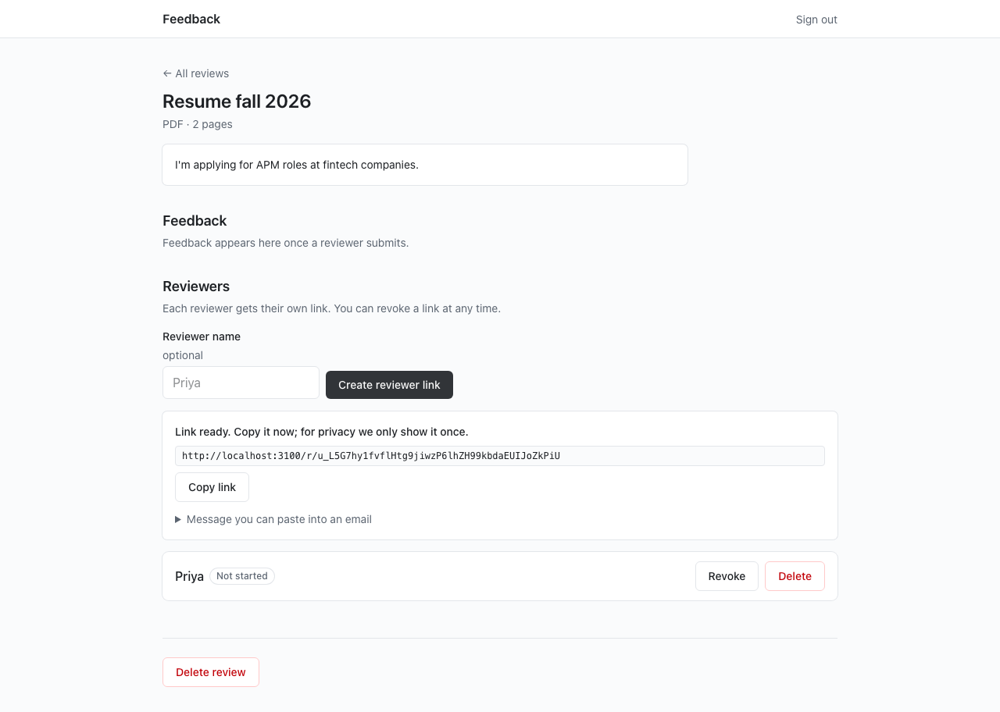
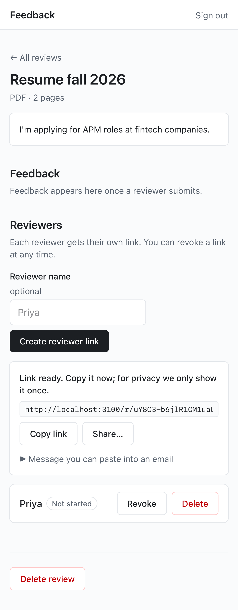

# M2: owner sign-in, PDF review creation, reviewer invites

## What / why
- **Auth (D6, D31):** magic link via local Supabase Auth. The email template links straight to `/auth/confirm` on the app origin, so it works through phone tunnels. Session cookies are httpOnly, and Next 16 `proxy.ts` refreshes them. The browser never talks to Supabase directly. Dev-only "Sign in as Jas" exists only when `NODE_ENV=development`: unit-tested guard, plus e2e proving the button is absent and `POST /api/dev/sign-in` returns 404 on the production build.
- **PDF review creation (SPEC §3.1):** `POST /api/reviews` creates the row and a signed upload URL (rewritten through `/sb`, D31). The browser uploads, then `POST /api/reviews/:id/pdf` validates server-side: `%PDF-` magic bytes, ≤15 MB, parseable by pdf.js, ≤30 pages. Bad files are deleted, the review is rolled back, and the error message says what to do.
- **Invites (D5):** 32-byte random token, only the SHA-256 is stored, link shown once with Copy / Share / ready-to-paste email text. Statuses, revoke, delete (removes that reviewer's audio/screenshots too).
- **Delete review:** typed confirmation (Radix dialog); storage objects removed first, failures queued in `storage_deletions`, then rows cascade.
- Rate limits (Postgres token bucket) on magic-link requests, review create, upload, invite create. `review_events` logged without content.

## Acceptance covered (partial M2)
- Owner auth (magic link via local inbox) + dev-only shortcut, test proving it's absent in production.
- Create PDF review, invites (reviewer link page, viewer and comments follow in the next slice).

## Screenshots

## Dependencies (runtime)
- `pdfjs-dist`: server-side PDF validation/page count now; the in-browser viewer next. Mozilla's reference implementation, no native deps.

## Manual checks
None new.

## Known limitations
- Website reviews show "coming soon" on the create form until M4.
- Supabase config now allows `http://localhost:3100/**` (e2e) as an auth redirect.
