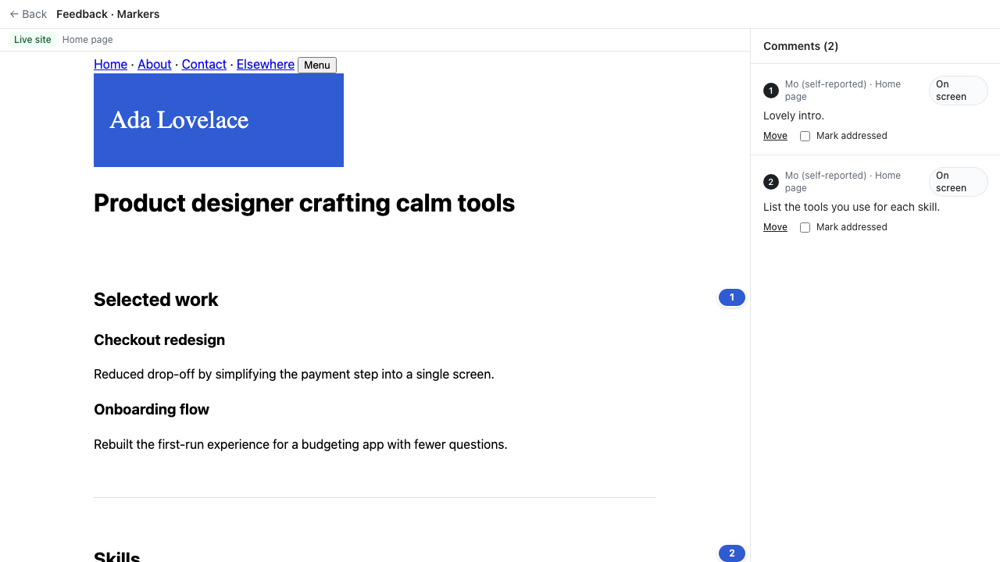
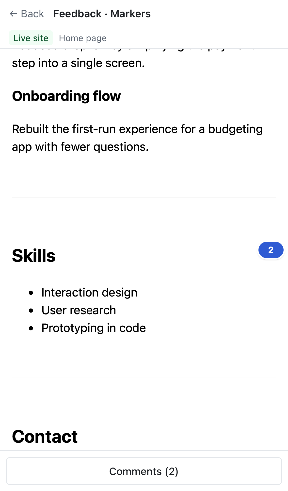

# Calmer markers: one pin per comment; the area band only for the comment you open

Jas, on her real review of jason-ng.space: the side indicator "stays on screen" even where she didn't look, and after opening comment 3 and scrolling she "never see[s] items 4 and 5".

## Cause (reproduced on her review)
- Older "On screen" comments have no stored mid-screen element, so each drew a band as tall as the reviewer's screen (about 900px). Eight overlapping bands covered most of the right edge, so a blue strip seemed to follow you everywhere.
- Each band's number sat only at its top, so it scrolled away while the strip stayed. Opening a comment drew a second copy of its number.
- Moving to another page did clear the markers (checked: `/` → `/playground`).

## What changed (overlay 0.4.0, unreleased → still 0.4.0)
- **One numbered pin per "On screen" comment** on the right edge: beside the stored mid-screen element, or at the middle of what the reviewer was looking at. No tall bands.
  - Pins never overlap, and have a white ring so they show on dark photos.
- **Opening a comment** shows one band for the area it was about, and highlights that comment's own pin (darker, slightly larger) instead of drawing a duplicate.
- Tapped comments are unchanged (outline plus number).

## Tests
- `e2e/site-markers.spec.ts` gains two checks: pins only (no bands) until a comment is opened; then exactly one band, with the opened comment's pin highlighted.
- Also re-ran `e2e/site-owner.spec.ts` in both browsers.

 

## Dev note
`pnpm dev` copies the overlay into the proxy only at start. After changing the overlay while dev is running, run `node scripts-gen-overlay.mjs` in `apps/proxy`, or restart dev.
