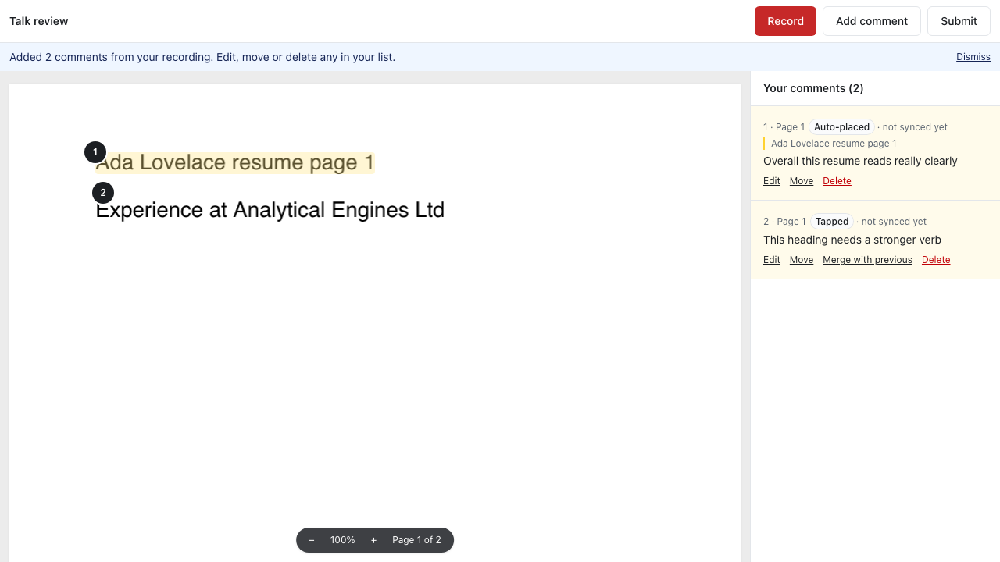
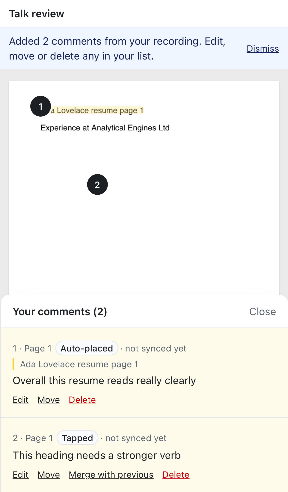

# Recorded comments go straight to the list (no "Here's what we heard" step)

Jas: "I'd rather the person edit their items in the column on the right… I'm reading these and then when they get uploaded to the right, I'm looking through them again."

## What changed
- **No preview step.** When a recording is processed, its comments are added straight to **Your comments**. They're highlighted for a few seconds, a notice says how many were added, and on a phone the list sheet opens.
  - This replaces SPEC §3.2 step 5's preview, at Jas's request (2026-11-06).
- **Everything the preview did now lives in the list:**
  - **Edit** (the existing editor);
  - **Move** (was "Re-anchor": tap Move, then tap the new spot; it becomes "Tapped");
  - **Merge with previous** (shown between two recorded comments);
  - **Delete**.
- Each recorded comment shows its source in the list ("Tapped", "Auto-placed", "On screen").
- **Fix: editing a recorded comment's words keeps its source.** It used to become "Typed".
- **Server:** merging now also works on comments that were already saved, because they no longer wait in a draft state for "Looks good". Sync is still refused once a review is submitted.
- Removed `PreviewSheet`. `useTalkThrough` now takes `onProposed`.

## Tests
These existing specs stepped through the preview and now check the same things in the list. No check was dropped; each one moved:
- `e2e/talk-through.spec.ts`:
  - the split shows "Auto-placed" and "Tapped" with the exact words;
  - the comments are saved with their sources;
  - offline upload;
  - merge (tapped anchor wins), move to page 2, edit, then the owner sees the source and transcript;
  - new: the "Added 2 comments" notice.
- `e2e/site-talk-through.spec.ts`, `e2e/screenshot-mode.spec.ts`, `e2e/load.spec.ts`: same assertions, read from the list.
- `e2e/a11y.spec.ts`: the axe scan that covered the preview now covers the list with fresh recorded comments.
- New helper `closeList` (`e2e/helpers/talk.ts`).

 

No new dependencies.

## Known limitations
- Merge is only offered between two recorded comments next to each other in the list.
- The "Added N comments" notice stays until dismissed or the next notice.
