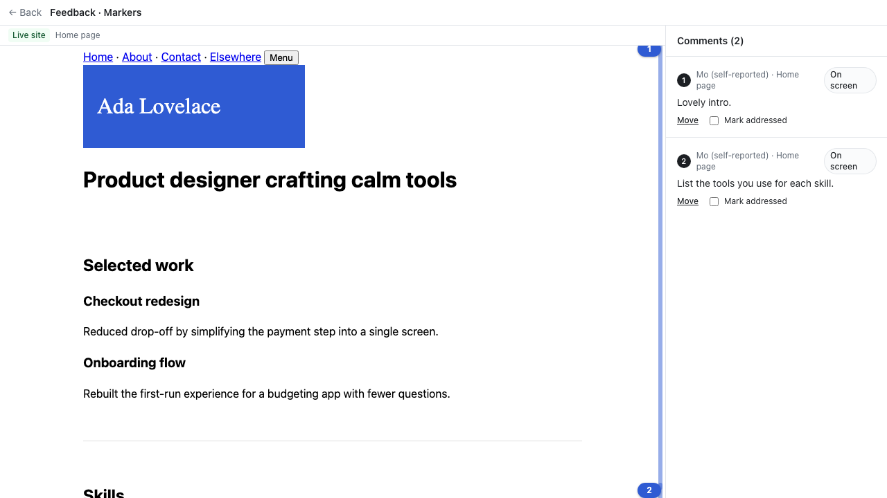
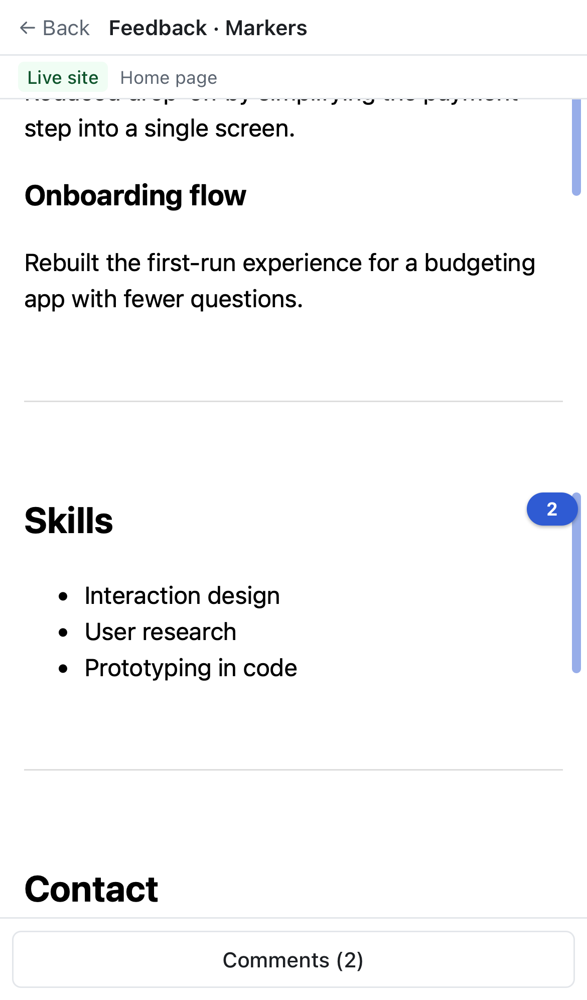

# See every comment on the live site

Jas: "would love to be able to scroll the site and SEE where the feedback was."

## What changed
- **Every pinned comment shows on the owner's live site.** Before, only tapped comments had a marker. "On screen" comments (talk without a tap) now get a numbered band down the right edge, beside the area the reviewer was looking at. Numbers never overlap and never sit above the top of the page. Markers redraw when the page resizes or finishes loading, and stay visible after you jump to a comment.
- **Click a number on the page to select its comment** in the list (it opens the sheet on a phone), the same as on PDFs. Numbers are buttons (Enter works) and only respond while browsing, not while moving a comment.
- **Bands land on the right area across devices.** A viewport anchor now also stores the element across the middle of the screen at that moment (`focus`, picked server-side from the timeline snapshot: the smallest element at least a third of the screen wide crossing the centre line). The owner's band is drawn beside that element, so it's right even when the reviewer's phone and the owner's laptop lay the page out differently. Older comments without it fall back to the scroll position.
- **No false "this part has changed" note** on "On screen" comments. It now shows only when the stored mid-screen element can't be found.
- The proxy address is stripped from the nested element too (`cleanAnchor`). The overlay is now 0.4.0.

## Tests
- `apps/web/test/viewport-focus.test.ts`: focus choice and fallback, untapped talk carries a focus, the nested address is cleaned.
- `e2e/site-markers.spec.ts`, in both browsers: numbered bands appear, band 2 is beside the Skills heading, clicking a number selects the comment, no "changed" note, and markers stay after a jump.

 

No new dependencies.

## Known limitations / next
- Comments recorded before today have no mid-screen element, so their bands use the scroll position, which can be off when the owner's screen differs.
- Reviewers can't yet fix a placement themselves before sending (owners can, with **Move**).
- A heat map across many reviewers is a later step.
