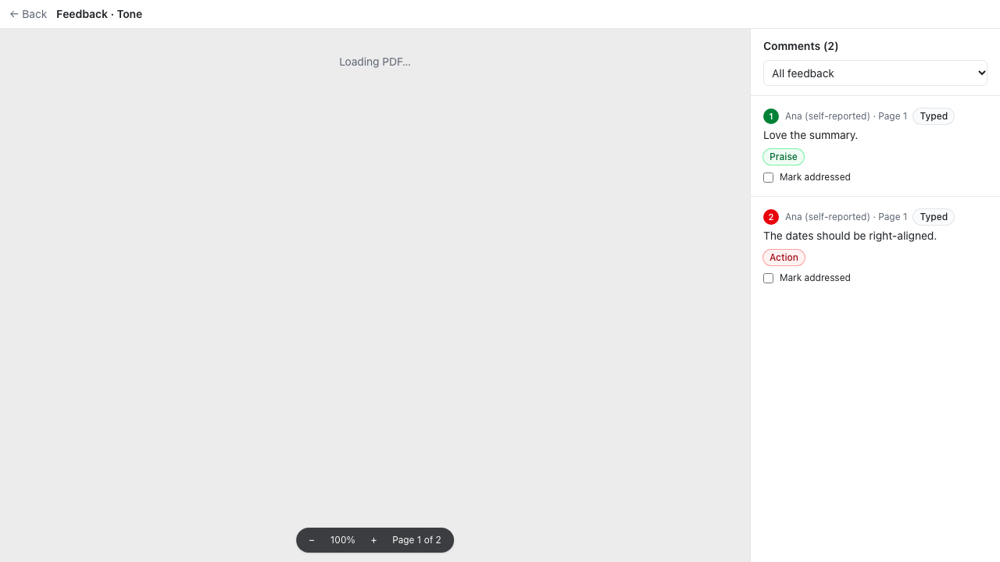
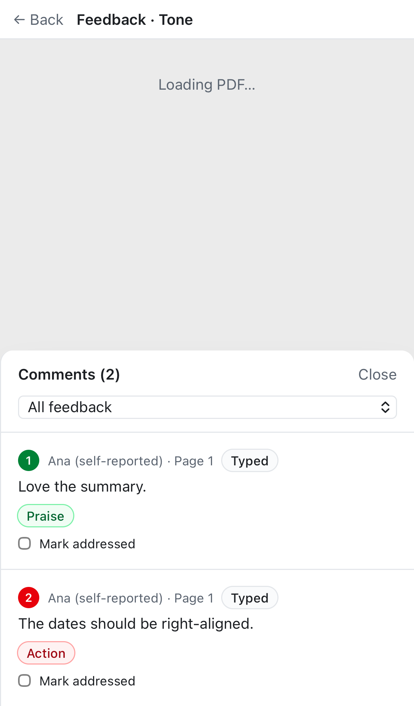

# Tone colours for the owner: Action (red), Praise (green), Note (blue)

Jas: "would be interesting if you could gauge sentiment and colour code the feedback. Red means action and blue or green is positive/praise or neutral."

## What changed
- **Each submitted comment gets a tone**, for the owner only:
  - **Action** (red): a problem, criticism, confusion, question or suggestion. Mixed comments count as Action.
  - **Praise** (green): positive only.
  - **Note** (blue): neutral narration.

  Tone is always shown as a word as well as a colour.
- **Where:**
  - a label on each comment in the owner's list; click it to change (Action → Praise → Note);
  - the comment number in the list;
  - the markers on PDFs, screenshots and live sites (pins and outlines);
  - a **Filter by tone** menu (All / Action only / Praise only / Notes only).
- **How:**
  - A new D30 interface, `ToneClassifier`, with `mock` (keyword rule, used in tests) and `local` (Ollama, same model as the anchor resolver; nothing leaves the Mac). Selected by `TONE_CLASSIFIER` (added to `.env.example` and the generated dev env).
  - It runs right after submit (`after()`), plus the hourly job as a retry, newest first, in batches of 20.
  - Output is zod-validated. Unknown ids are ignored, and each comment is labelled once.
  - It only writes the `tone` column and never overwrites the owner's choice. Logs carry no content.
- **Data:** migration `20261106000001_comment_tone.sql` adds `comments.tone` (enum) and `tone_source` (`ai` | `owner`), plus a column grant so owners can update only those (RLS still limits them to their own reviews).
- **Reviewers never see tones:** the reviewer sync doesn't select the column. The reviewer's words are never changed.

## Checked with the real local model on Jas's jason-ng.space feedback
25 comments in about 40 s. Clear criticism ("This header looks pretty ugly", "I can't read") came out as Action, compliments as Praise, and narration as Note. Mixed comments lean Action. An early prompt labelled plain criticism as Note; the prompt now spells out that criticism is Action and gives examples.

## Tests
- `apps/web/test/tone.db.test.ts`:
  - the mock rule;
  - `classifyPending` labels submitted comments only, never overwrites the owner, and never changes the words;
  - owners can change tone but not text;
  - strangers can't change either.
- `e2e/tone.spec.ts`, in both browsers: a reviewer submits, the owner sees Praise and Action with a red number, the filter shows Action only, and changing a label saves `tone_source = owner`. Reviewers see no tones.

 

No new dependencies.

## Known limitations
- Labels appear a few seconds after submit (the owner refreshes to see them). If the model is down, the hourly job fills them in.
- The tone is a suggestion: the owner can change it, and the model can be wrong on sarcasm or fragments.
