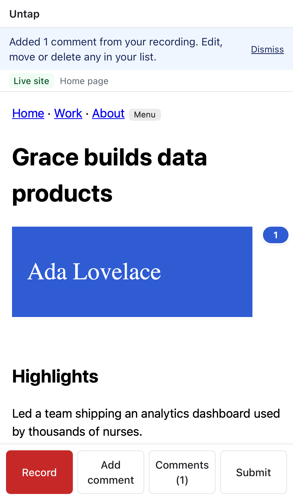
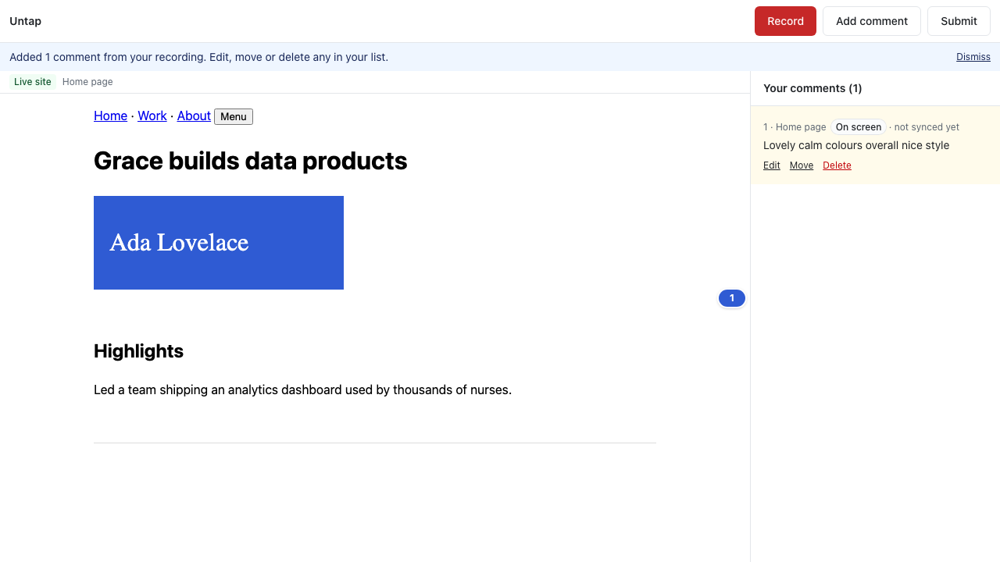

# Take a tap back while recording; reviewers see pins too

Jas, testing:
1. "If you do decide to click to leave feedback, you cannot unclick it, it just piles more clicks on top."
2. "When I scroll, the numbered feedback isn't visible unless I click on it… I should be able to scroll and see all comments 1–7." (Her test was on the **reviewer** page; the link wasn't submitted yet.)

## What changed
- **Tap again to undo.** While recording on a website, tapping the same thing a second time removes that tap: its outline and number disappear, and it no longer splits or anchors the talk. On a PDF, tapping a tap's number removes it.
  - The recording bar says "Tap again to undo" (short form on phones).
  - New overlay→app message: `tap:undo` (eid), validated like the rest.
- **Reviewer page shows "On screen" pins.** The reviewer page only sent tapped comments to the site; the owner view was fixed earlier, this page wasn't. "On screen" comments now get the same numbered pins, and clicking a pin selects that comment in **Your comments**.

## Tests
- New `e2e/untap.spec.ts`, in both browsers:
  - tap, then tap the same heading again: the marker is gone, and the comment comes out "On screen", not "Tapped";
  - the reviewer sees pin 1, and clicking it selects the comment.
- New test in `e2e/talk-through.spec.ts`: on a PDF, two taps, then tapping "Tap 1" leaves one.

 

No new dependencies.

## Known limitations
- Tap numbers aren't renumbered after an undo on websites (they're just labels while recording).
