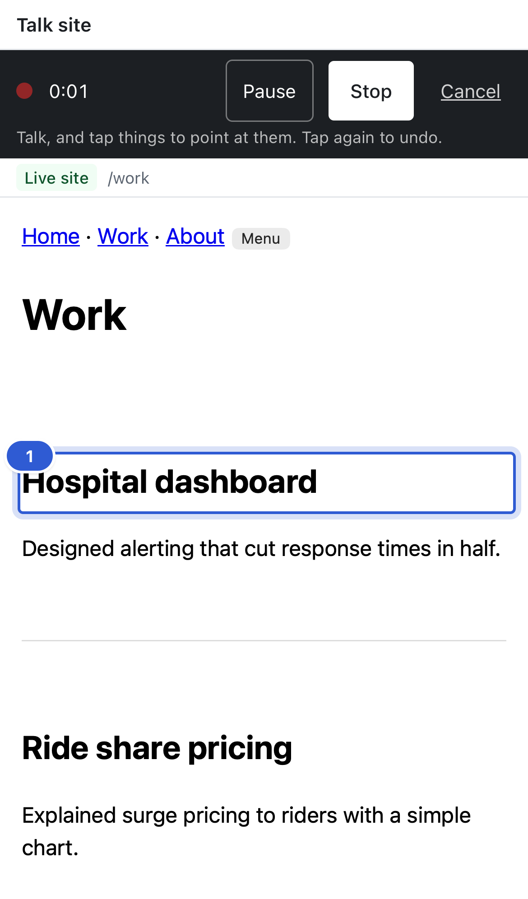
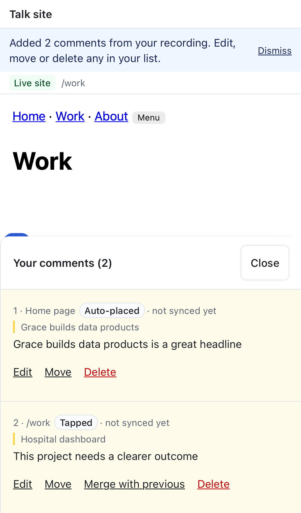
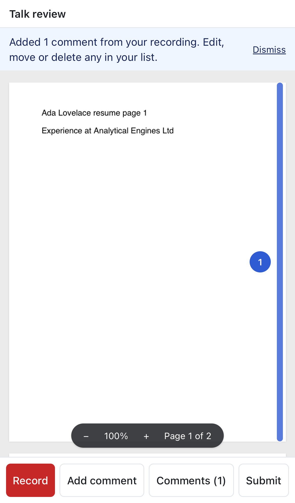
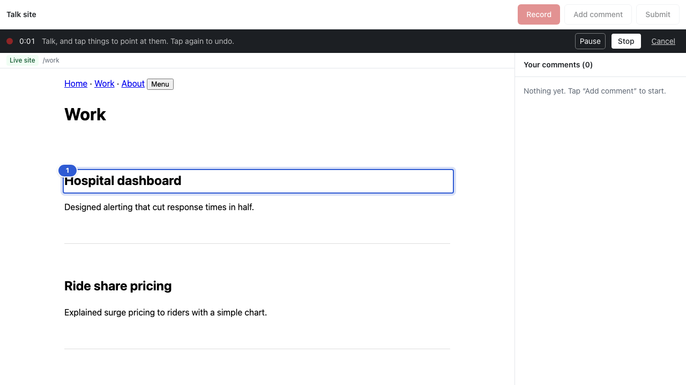

# Mobile pass for reviewers (resume and website)

Jas: "We will also have to optimize for mobile view, so if someone is giving a review on a mobile device for a resume or website, both will also need to be optimized."

I reviewed every iPhone screenshot the e2e suite takes (reviewer and owner, PDF and website) and fixed what didn't fit:
- **Recording bar:** the hint was cut off ("Tap again to u…"). On phones it now sits on its own line under the controls. Pause, Stop and Cancel are at least 44 pt tall.
- **Bottom action bar:** "Add comment" and "Comments (n)" wrapped onto two lines. The buttons now size to their labels on one line, and all are at least 44 pt tall.
- **Comment list actions** (Edit, Move, Merge with previous, Delete): larger text and 44 pt tap targets on phones. Desktop is unchanged.
- **Comment sheet:** **Close** is now a real button, and the sheet is a bit shorter (62% of the screen), so more of the page and its pins stay visible.

Things that already worked on phones and didn't change: the PDF fits the width with zoom, the composer sits above the keyboard area, websites render at phone width with tap-to-comment and pins, and the owner view uses a bottom sheet.

Tests: no test changes; all 56 iPhone e2e tests pass.

   

## Still to check on a real phone (added to MANUAL_CHECKS)
Pinch-zoom on PDFs while recording, the keyboard covering the composer on small iPhones, and the comment sheet with long lists.
