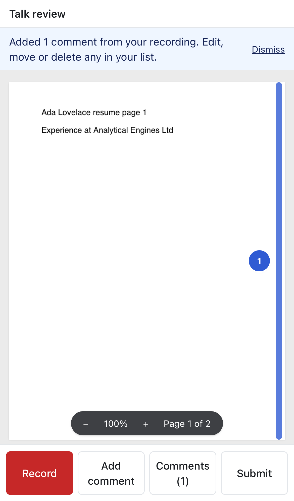
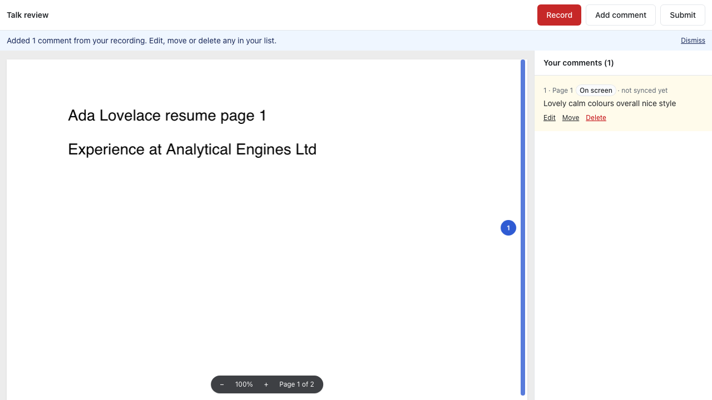

# Opened comments keep their pin; PDF comments pinned to what was on screen

Jas:
1. "When you click back on the feedback in the website review, the number on the page disappears. I still want that visible with the bar for the area of feedback."
2. "For the PDF review, I'd like a similar scroll and auto tagging the feedback based on what's on screen at the time."

## 1. The opened comment's pin stays visible
Reproduced on her jason-ng.space review: opening a comment turned its pin near-black. On a dark site it vanished, and the area band was a thin dark strip.

The opened pin now keeps its tone colour (red, green or blue). It grows, gets a white ring and a soft halo, and its band is thicker and the same colour, with a white edge. Overlay 0.4.0, unchanged version (unreleased).

## 2. PDF: "On screen" comments get pins at the part of the page you were looking at
- While recording, each PDF snapshot now also stores `region`: the part of the current page that was on screen, as fractions of page height, so it doesn't depend on zoom or screen size. This is a new optional field on `PdfPageAnchor`; older comments don't have it.
- Untapped talk was already split when you scrolled or changed page. Those comments now show as numbered pins on the page's right edge, at the middle of the area (both for reviewers and owners). Nearby pins stack instead of overlapping, and pins use the tone colours.
- Opening a comment (or clicking its pin) scrolls to it and shows a band down the area.

## Tests
- New in `e2e/talk-through.spec.ts`: untapped talk on a PDF shows pin "Comment 1", no band until opened, then one band.
- `e2e/site-markers.spec.ts` still passes (the opened pin is highlighted, with one band).

 

No new dependencies.
